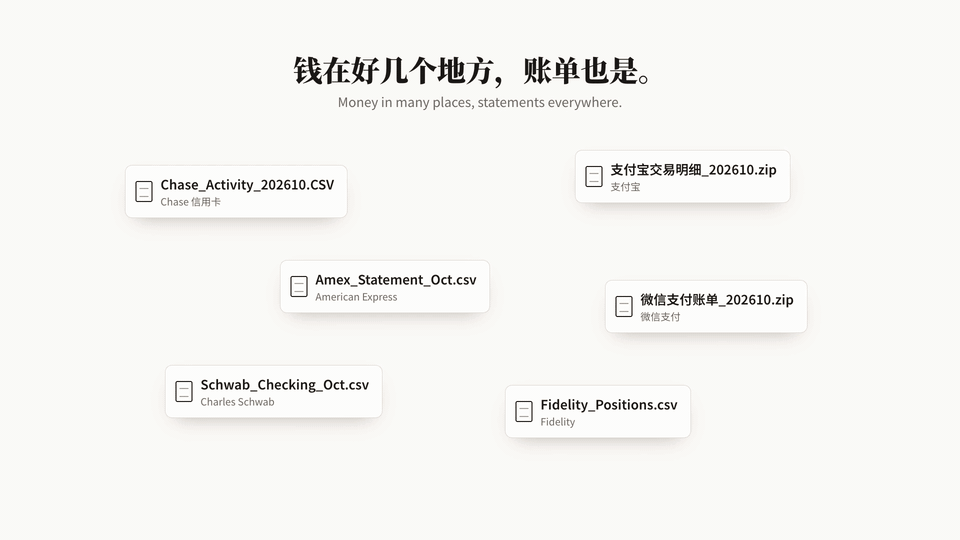

<p align="center">
  
</p>

<h1 align="center">Keel 龙骨</h1>

<p align="center">
  Free, open-source personal finance for the Mac.<br/>
  Drop in your bank, card, Alipay and WeChat statements: Keel keeps the books,<br/>
  reconciles them against your banks, and shows where the money goes and where it can take you.<br/>
  Your data stays on your Mac: no account, no subscription, no cloud.
</p>

<p align="center">
  <a href="README.zh.md">中文文档</a> · <a href="https://realallensong.github.io/Keel/">Website</a> · <a href="https://realallensong.github.io/Keel/">Download</a>
</p>

<p align="center">
  <a href="LICENSE"></a>
  
  <a href="https://github.com/realAllenSong/Keel/releases/latest"></a>
  <a href="https://github.com/realAllenSong/Keel/releases"></a>
</p>

<p align="center">
  <a href="https://realallensong.github.io/Keel/#film"></a>
  <br/><sub>Made-up household and brokerage account. <a href="https://realallensong.github.io/Keel/#film">Watch the full video with sound</a>.</sub>
</p>

---

Keel is a household ledger for people whose money lives in more than one place: US banks and
brokers, a Chinese bank account, Alipay and WeChat Pay. Drop in the statements you already
download, or link your banks, and Keel books every line in a double-entry ledger, pairs your card
payments and transfers so nothing is counted twice, and checks each account against the balance
the bank reports. From that ledger it answers the questions that matter: where did the money go
this month, what leaves every month no matter what, how are my investments doing against the
market, and does my cash last.

Everything runs on your Mac. Statements, the ledger and its backups are files in
`~/Library/Application Support/Keel`; bank and broker keys are in the macOS Keychain. Nothing is
uploaded, and there is no account to make.

## Features

**Books that add up**

- Reads statement files from Chase, American Express, Bank of America, Charles Schwab, Fidelity,
  Interactive Brokers, Alipay, WeChat Pay, China Merchants Bank, Bank of Ningbo and OKX, including
  password-protected archives. Any other bank's CSV or Excel layout is taught once.
- Double-entry accounting with exact decimals: every transaction balances, card payments and
  moves between your own accounts are transfers, never spending.
- Reconciles every account against the balance on its statement or bank feed, and tells you when
  a line is missing. A card payment that has left the bank but not reached the card yet is
  understood, not reported as a gap.
- Categories that learn: fix one line and the merchant follows from then on. Split a line, edit
  it, add cash by hand; your fixes survive re-imports.

**See it**

- **Monthly:** a daily spending table and spending by category against your usual month; a whole
  year on one page.
- **Bills:** rent, phone, subscriptions and annual fees found in your history, with the day they
  land, the next date and a note when a price goes up. Say "not a bill" once and it stays gone.
- **Holdings:** each position's value, cost and gain at delayed market quotes; realised gains
  first in first out with a short/long-term and wash-sale view; and how the same money would have
  done in QQQ or SPY on the same days. Export a period's accounts, holdings and trades as CSV for
  an employer's brokerage certification.
- **Tags** total a trip or a move across categories; **savings goals** show when you get there at
  the pace you have been saving.

**Plan**

- Whether your cash lasts the next 24 months, net worth in 1, 3 and 5 years, and when work becomes
  optional, simulated over 150 years of market history.
- Backtests (monthly investing against waiting for a dip) and rent-or-buy and mortgage calculators.

**Runs itself**

- Linked banks and brokers sync every morning, even when Keel is closed. Statements you download
  are picked up from Downloads or your mailbox.
- A month whose accounts are all in and agree closes by itself; if its numbers change later, you
  are told.
- Nightly verified backups, optionally to iCloud Drive. Updates install from Settings.

**For your AI agents**

- A `keel` command line, a skill for coding agents and an MCP server, so Claude, Codex or any MCP
  client can read and update your ledger on your Mac. See [For agents](#for-agents).

## Download

Download **Keel.dmg** from the [website](https://realallensong.github.io/Keel/) or the
[latest release](https://github.com/realAllenSong/Keel/releases/latest), open it and drag Keel
into Applications. It is signed with an Apple Developer ID and notarized, so it opens without
warnings.

Requires a Mac with Apple silicon (M1 or later) and macOS 14 or later.

## Using Keel

1. **Add statements.** Drop the files your bank, card, Alipay or WeChat exported into the window.
   Keel recognises the format, asks which account a new file belongs to once, and books it.
2. **Link accounts (optional).** In Settings › Advanced, connect banks and cards through
   [Plaid](https://plaid.com) or [SimpleFIN Bridge](https://bridge.simplefin.org), brokers and
   exchanges through [SnapTrade](https://snaptrade.com) (Fidelity, Schwab, IBKR, Robinhood, Moomoo,
   Kraken and others) or IBKR Flex, OKX with a read-only API key, and a mailbox that receives
   statements. Each uses your own account with that service; Keel only reads.
3. **Look.** Monthly, Calendar, Bills, Holdings and Plan cover the rest. Settings holds your
   budget, low-cash alert, planning assumptions, backups and language.

Keel works in US dollars and Chinese yuan. Holdings in other currencies are converted for reports.

## Privacy and network use

Your statements, ledger, backups and planning are on your Mac only. Keel goes online for:

- the bank, broker and mailbox connections you set up yourself;
- market data: FX rates and rates from FRED, stock prices and index history from Yahoo Finance;
- checking GitHub for a new release.

There is no telemetry and no Keel server.

## For agents

The same core serves three surfaces, with the app open or closed:

- **CLI** `keel <command> [--json]`: `status`, `summary`, `transactions`, `assets`, `holdings`,
  `trades`, `gains`, `brokerage-report`, `bills`, `tags`, `goals`, `review`, `categorize`, `add`,
  `import`, `sync`, `check-balance`, `plan`, `close`, `doctor`. Never interactive; on failure it
  exits 1 with `{ok, error, message, fix}`. Installed to `~/.local/bin/keel` by
  `scripts/install-agent.sh`.
- **Skill** [`skills/keel`](skills/keel/SKILL.md): when and how to use the CLI, for Claude Code,
  Codex and other coding agents. It also explains how an agent turns a PDF or screenshot
  statement into lines Keel imports and checks.
- **MCP** `keel mcp` (stdio, 20 `keel_*` tools) for chat apps without a shell. In Claude
  Desktop's config: `{"mcpServers": {"keel": {"command": "/Users/you/.local/bin/keel", "args": ["mcp"]}}}`.

## Updates

Settings › Version and updates checks GitHub for a new release, downloads it, verifies the Apple signature
and notarization, and restarts into it. Your data is untouched.

## Troubleshooting

**A balance doesn't match the bank.** Open Assets: the account shows the gap and the day it
started. Usually a statement period is missing; import it, or tell Keel the real balance
(Check balance) and it reconciles to it. A gap from the last few days is usually a line the bank
hasn't sent yet and resolves at the next sync.

**A file isn't recognised.** Keel shows it under Pending statements and lets you map its columns
once; the layout is remembered for next time.

**A WeChat or Alipay archive asks for a password.** The code is sent to you by WeChat Pay or
Alipay when you request the export. Enter it once in the pending file; Keel remembers recent codes.

**Holdings are a day behind.** Brokers report positions and trades once a day; prices on the
Holdings page are delayed quotes. Use Sync brokers to fetch again.

## Build from source

Requires macOS 14+, Xcode command line tools and [uv](https://docs.astral.sh/uv/).

```bash
git clone https://github.com/realAllenSong/Keel.git && cd Keel
make hooks         # once: privacy and lint hooks
make seed-demo     # a synthetic household in data/demo.db
make dev-demo      # the engine on the demo ledger (127.0.0.1:8711) …
make run           # … and the SwiftUI app from source against it
make test          # engine tests, translations, Swift tests
make app           # dist/Keel.app with the engine bundled, signed ad hoc without a Developer ID
make install       # build and replace /Applications/Keel.app (your data is kept and backed up)
```

Statement layouts for Chase, Amex and Bank of America are YAML files in
`backend/pf/importers/profiles/`; a new bank is usually a new file. Tests run on synthetic
statements only (`fixtures/`); never commit real statements or ledgers.

## Tech stack

- **App:** SwiftUI and Swift Charts, macOS 14+ ([apple/README.md](apple/README.md)).
- **Engine:** Python 3.12, FastAPI on a local port, SQLite (STRICT tables and triggers keep every
  transaction balanced), Alembic migrations, numpy and pandas, bundled with PyInstaller
  ([desktop/README.md](desktop/README.md)).
- **Design:** ink and paper editorial, described in [DESIGN.md](DESIGN.md). Interface in Chinese
  and English, light and dark.

## FAQ

**Is Keel free?** Yes, and open source under AGPL-3.0. Some bank-connection services it can link
to (Plaid, SimpleFIN Bridge, SnapTrade) are run by others and have their own plans.

**Does Keel see my bank password?** No. Links go through each service's own sign-in; Keel stores
only the read-only key or token it receives, in the Keychain.

**Is there an iPhone or Windows version?** Not yet. Keel is a Mac app.

**Which currencies?** US dollars and Chinese yuan. Holdings in other currencies convert into them.

**Can I move my data?** It is a SQLite file plus your original statements in
`~/Library/Application Support/Keel`, and `pf decisions export` writes your rules, fixes and
valuations to a portable file.

## Contributing

Issues and pull requests are welcome; see [CONTRIBUTING.md](CONTRIBUTING.md).

## License

Keel is free software under the [GNU Affero General Public License v3](LICENSE). Copyright ©
2026 realAllenSong. If you share Keel or a work based on it, or run it for others over a network,
keep the attribution "Based on Keel by realAllenSong" (see [NOTICE](NOTICE)) and publish your source
under the same license.

## Acknowledgments

Market history from [FRED](https://fred.stlouisfed.org) and Robert Shiller's
[long-term stock data](http://www.econ.yale.edu/~shiller/data.htm); prices through
[yfinance](https://github.com/ranaroussi/yfinance). Fonts: [Geist](https://vercel.com/font) (SIL
Open Font License).
