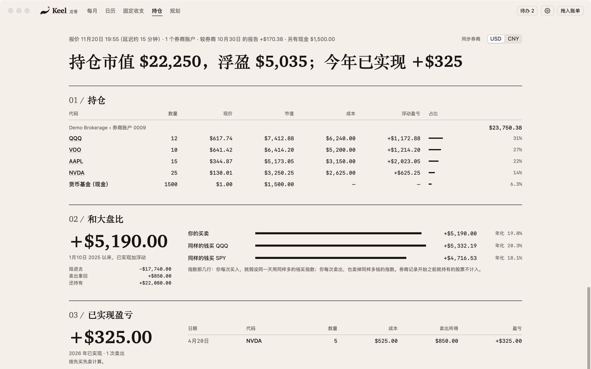

<p align="center">
  
</p>

<h1 align="center">Keel 龙骨</h1>

<p align="center">
  免费、开源的 Mac 个人记账与财务规划。<br/>
  把银行、信用卡、支付宝和微信的账单拖进来，Keel 自动记账，和银行对账，<br/>
  告诉你钱花在哪里、接下来能走多远。<br/>
  数据只在你的 Mac 上：不用注册，不用订阅，不上传任何东西。
</p>

<p align="center">
  <a href="README.md">English</a> · <a href="https://realallensong.github.io/Keel/">官网</a> · <a href="https://realallensong.github.io/Keel/">下载</a>
</p>

<p align="center">
  <a href="LICENSE"></a>
  
  <a href="https://github.com/realAllenSong/Keel/releases/latest"></a>
  <a href="https://github.com/realAllenSong/Keel/releases"></a>
</p>

<p align="center">
  
  <br/><sub>截图用的是虚构的家庭和券商账户。</sub>
</p>

---

Keel 是给"钱不止放在一个地方"的人用的家庭账本：美国的银行和券商、国内的银行卡、支付宝、微信支付。你把平时就会下载的账单拖进来，或者直接连上银行，Keel 会把每一笔记进复式账本，自动识别信用卡还款和自己账户之间的转账，不重复计算，再拿每个账户的银行余额来核对。在这本账的基础上，它回答几个真正重要的问题：这个月钱花在哪了，每个月雷打不动要出去多少，投资和大盘比怎么样，现金够不够用。

所有计算都在你的 Mac 上完成。账单、账本和备份都是 `~/Library/Application Support/Keel` 里的文件，银行和券商的授权存在 macOS 钥匙串里。不上传任何数据，也没有账号可注册。

## 功能

**账要对得上**

- 认得 Chase、American Express、Bank of America、Charles Schwab、Fidelity、盈透（IBKR）、支付宝、微信支付、招商银行、宁波银行和 OKX 导出的账单，包括加了密码的压缩包。其他银行的 CSV 或 Excel，教一次格式就记住了。
- 复式记账，金额精确到分：每一笔都收支平衡，信用卡还款和自己账户之间的转账只算转账，不算花销。
- 每个账户都和账单或银行同步来的余额核对，少了哪笔会告诉你。银行已经扣款、信用卡那边还没入账的还款，会被正确识别，不会误报。
- 分类会学习：改一次，同一个商户以后自动归好。也可以拆分、修改、手动记一笔现金，重新导入时你的修改都会保留。

**看得清**

- **每月**：一张每日支出表，加上各类别和平时相比；一整年的账也能一页看完。
- **固定收支**：从流水里自动找出房租、话费、订阅和年费，标出每月几号扣、下次什么时候，涨价会提醒。点一次"不算"，以后都不再出现。
- **持仓**：每只股票的市值、成本和盈亏（延迟约 15 分钟的行情）；按先买先卖算的已实现盈亏，附短期、长期和洗售的报税口径；还有"同样的钱、同一天买 QQQ 或 SPY 会怎样"。可以按时间段导出账户、持仓和交易记录，用于公司的券商账户申报。
- **标签**把一次旅行、一次搬家跨类别加总；**存钱目标**按你最近每月存下的速度，算出什么时候达成。

**算得远**

- 接下来 24 个月现金够不够、1 年 3 年 5 年后有多少、什么时候可以不用工作，用 150 多年的市场历史来模拟。
- 回测（每月定投和等跌了再买比），以及租房买房、房贷计算器。

**自己会跑**

- 连上的银行和券商每天早上自动同步，Keel 没打开也会同步。下载到"下载"文件夹或邮箱里的账单会被自动认领。
- 一个月的账户都齐了、余额都对上，就自动结账；之后那个月的数字再变，会提醒你。
- 每晚自动备份并校验，可以备份到 iCloud 云盘。新版本在设置里一键更新。

**给你的 AI 助手用**

- 提供 `keel` 命令行、给编程类 AI 用的技能说明，以及 MCP 服务，Claude、Codex 或任何支持 MCP 的应用都能在你的 Mac 上读写这本账。见[给 AI 助手](#给-ai-助手)。

## 下载

在[官网](https://realallensong.github.io/Keel/)或[最新版本页](https://github.com/realAllenSong/Keel/releases/latest)下载 **Keel.dmg**，打开后把 Keel 拖进"应用程序"。安装包有 Apple 开发者签名并经过公证，打开时不会有警告。

需要 Apple 芯片（M1 或更新）的 Mac，以及 macOS 14 或更新。

## 怎么用

1. **加账单**：把银行、信用卡、支付宝或微信导出的文件拖进窗口。Keel 会识别格式；遇到新文件，问你一次它属于哪个账户，然后记账。
2. **连账户（可选）**：在 设置 › 高级 里，通过 [Plaid](https://plaid.com) 或 [SimpleFIN Bridge](https://bridge.simplefin.org) 连银行和信用卡；通过 [SnapTrade](https://snaptrade.com)（Fidelity、Schwab、盈透、Robinhood、moomoo、Kraken 等）或盈透 Flex 连券商和交易所；用只读 API Key 连 OKX；还可以连一个接收账单的邮箱。每一项用的都是你自己在这些服务上的账户，Keel 只读不写。
3. **看**：每月、日历、固定收支、持仓、规划这几页就够了。预算、现金最低余额提醒、规划假设、备份和语言都在设置里。

Keel 支持美元和人民币。其他币种的持仓会折算进来。

## 隐私与联网

账单、账本、备份和规划只存在你的 Mac 上。Keel 只在这些时候联网：

- 你自己设置的银行、券商和邮箱连接；
- 行情数据：汇率和利率来自 FRED，股价和指数历史来自 Yahoo Finance；
- 去 GitHub 检查有没有新版本。

没有数据统计，也没有 Keel 自己的服务器。

## 给 AI 助手

同一套核心代码提供三种接入方式，Keel 开着或关着都能用：

- **命令行** `keel <命令> [--json]`：`status`、`summary`、`transactions`、`assets`、`holdings`、`trades`、`gains`、`brokerage-report`、`bills`、`tags`、`goals`、`review`、`categorize`、`add`、`import`、`sync`、`check-balance`、`plan`、`close`、`doctor`。不会弹出交互；出错时返回 1 和 `{ok, error, message, fix}`。由 `scripts/install-agent.sh` 安装到 `~/.local/bin/keel`。
- **技能说明** [`skills/keel`](skills/keel/SKILL.md)：告诉 Claude Code、Codex 等编程类 AI 什么时候用、怎么用，也写了怎样把 PDF 或截图里的账单整理成 Keel 能导入、能核对的格式。
- **MCP** `keel mcp`（stdio，20 个 `keel_*` 工具），给没有终端的聊天应用用。Claude Desktop 的配置：`{"mcpServers": {"keel": {"command": "/Users/你的用户名/.local/bin/keel", "args": ["mcp"]}}}`。

## 更新

设置 › 版本与更新 会去 GitHub 检查新版本，下载后核对 Apple 签名和公证，再自动重启到新版本。你的数据不受影响。

## 常见问题排查

**余额和银行对不上**：打开"资产"，那个账户会显示差了多少、从哪天开始。通常是漏导了某段时间的账单，补上即可；也可以用"核对余额"告诉 Keel 真实余额，它会据此对平。最近几天出现的差额，多半是银行还没把那笔流水发过来，下次同步就好。

**文件认不出来**：它会出现在"待处理账单"里，你可以对一次各列的含义，以后同样格式的文件就都认得了。

**微信或支付宝的压缩包要密码**：解压码是你申请导出时，微信支付或支付宝发给你的。在待处理的文件里输一次，Keel 会记住最近用过的几个。

**持仓慢了一天**：券商每天报告一次持仓和交易；持仓页的价格是延迟行情。点"同步券商"可以马上再取一次。

## 从源码构建

需要 macOS 14 以上、Xcode 命令行工具和 [uv](https://docs.astral.sh/uv/)。

```bash
git clone https://github.com/realAllenSong/Keel.git && cd Keel
make hooks         # 首次：隐私检查和代码风格检查
make seed-demo     # 在 data/demo.db 生成一个虚构的家庭账本
make dev-demo      # 引擎跑在演示账本上（127.0.0.1:8711）……
make run           # ……再从源码运行 SwiftUI App 连上它
make test          # 引擎测试、翻译检查、Swift 测试
make app           # 生成 dist/Keel.app（内置引擎；没有开发者证书时用临时签名）
make install       # 构建并替换 /Applications/Keel.app（数据保留并先备份）
```

Chase、Amex 和 Bank of America 的账单格式是 `backend/pf/importers/profiles/` 里的 YAML 文件，新增一家银行通常只要加一个文件。测试只用虚构的账单（`fixtures/`），请不要提交真实的账单或账本。

## 技术栈

- **App**：SwiftUI 和 Swift Charts，macOS 14+（[apple/README.md](apple/README.md)）。
- **引擎**：Python 3.12，本地端口上的 FastAPI，SQLite（STRICT 表加触发器保证每笔交易平衡），Alembic 迁移，numpy 和 pandas，用 PyInstaller 打包进 App（[desktop/README.md](desktop/README.md)）。
- **设计**：宣纸水墨的编辑部风格，见 [DESIGN.md](DESIGN.md)。界面有中英文、浅色和深色。

## 常见问题

**免费吗？** 免费，并且按 AGPL-3.0 开源。它能连接的一些银行数据服务（Plaid、SimpleFIN Bridge、SnapTrade）由第三方提供，有各自的收费方式。

**Keel 能看到我的银行密码吗？** 看不到。连接都通过各家服务自己的登录页面完成，Keel 只保存拿到的只读授权，存在钥匙串里。

**有 iPhone 或 Windows 版吗？** 暂时没有，目前只有 Mac 版。

**支持哪些币种？** 美元和人民币。其他币种的持仓会折算成这两种。

**数据能导出吗？** 能。数据就是 `~/Library/Application Support/Keel` 里的一个 SQLite 文件加上你的原始账单；`pf decisions export` 还能把你的分类规则、修改和估值导出成一个可迁移的文件。

## 参与贡献

欢迎提 Issue 和 Pull Request，见 [CONTRIBUTING.md](CONTRIBUTING.md)。

## 许可证

Keel 是自由软件，采用 [GNU Affero 通用公共许可证 v3](LICENSE)。版权所有 © 2026 realAllenSong。分发 Keel 或基于它修改的作品，或者通过网络把它提供给别人使用时，必须保留署名 "Based on Keel by realAllenSong"（见 [NOTICE](NOTICE)），并以同样的许可证公开源代码。

## 致谢

市场历史数据来自 [FRED](https://fred.stlouisfed.org) 和 Robert Shiller 的[长期股市数据](http://www.econ.yale.edu/~shiller/data.htm)，股价通过 [yfinance](https://github.com/ranaroussi/yfinance) 获取。字体：[Geist](https://vercel.com/font)（SIL 开放字体许可证）。
